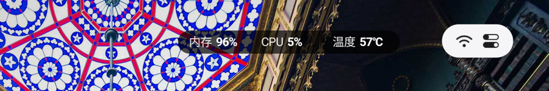
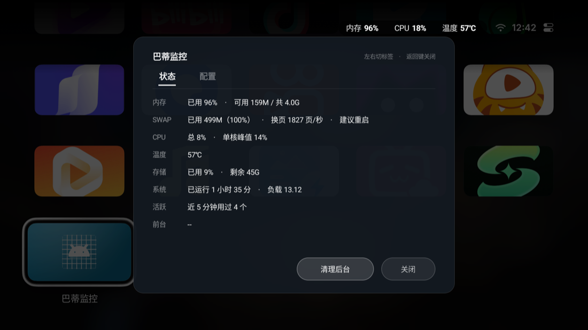
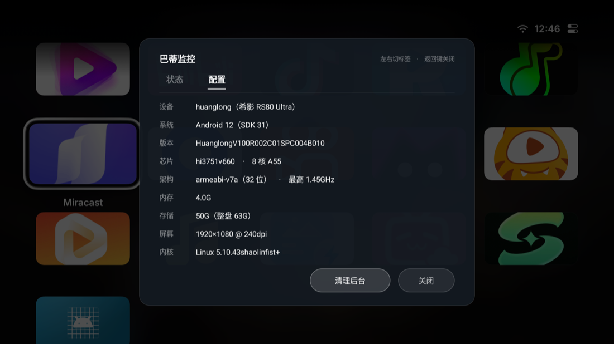

# 巴蒂监控 · Bati Hud

给 Android TV / 投影仪桌面加一条极简系统监控条。屏幕上只多三个数字：**内存、CPU、温度**。



<p>


</p>

---

## 它做什么

- 常驻右上角，跟系统的时间、Wi-Fi 图标**同一行**，不压应用图标
- 遥控器点一下展开面板，两页可切：
  - **状态**：内存 / SWAP / CPU / 温度 / 存储 / 系统 / 活跃应用数 / 当前前台应用
  - **配置**：设备型号、芯片、架构、内存、存储、屏幕、内核版本
- 底部有开关，可以随时关掉桌面条；开或关的记忆会带过重启
- 能认出桌面上的浮层（比如 Aerial 桌面的「个性化」面板），浮层一出现，监控条自动收起来让开

## 为什么写它

换了第三方桌面之后，右上角只剩时间和 Wi-Fi。想知道还剩多少内存、CPU 有没有跑满、机器烫不烫，只能退回设置里翻。

现成的监控 App 大多要 root，界面又是按手机竖屏做的，遥控器根本按不到。这个就是专门给「遥控器 + 横屏 + 无 root」这个组合写的。

## 兼容性

- Android 5.0（API 21）及以上
- 横屏电视、投影仪、电视盒子
- 只在 **希影 RS80 Ultra**（1920×1080、240dpi、Android 12、纯 32 位 ARM）上验证过，其他机型没测
- 浮层识别是按 Aerial 桌面调的；识别不到就不介入，不会挡住别的桌面

## 安装

**用现成的 APK**：从 Releases 下载 `BatiHud.apk`，然后

```bash
adb install -r BatiHud.apk
```

**自己编译**：需要 JDK 17 和 Android SDK（build-tools + 任一 platform）

```bash
export JAVA_HOME=/path/to/jdk-17
./build.sh
```

产物是 `BatiHud.apk`。脚本会自动找 SDK 和最新的 build-tools。第一次构建会用 `keytool` 生成自签名密钥 `hud.jks`——**别把它提交进版本库**，`.gitignore` 已经排除了。

## 要给的权限

| 权限 | 干什么用 | 必须吗 |
|---|---|---|
| 悬浮窗（在其他应用上层显示） | 画出监控条 | 必须 |
| 无障碍 | 认出桌面浮层，浮层出现时让开 | 可选，不给也能用，只是不会自动让 |
| 使用情况访问 | 面板里的「活跃应用」数量 | 可选 |
| 开机自启 | 开机后恢复上次的开关状态 | 可选 |

首次打开 App 会逐项引导你去系统里打开。

## 已知限制（照实说）

- **「清理后台」能力有限**。用的是 `killBackgroundProcesses`，它只杀纯后台（cached）进程。正在播放视频或音乐、或者持有前台服务的应用，系统会标记成 perceptible，这个方法动不了它们。想真正停掉只有 adb / root 的 `force-stop`，普通应用做不到。
- 清理后显示的「释放 XX MB」是真实测量值；但**没法统计杀掉几个**——现代 Android 的 `/proc` 是 `hidepid`，普通应用看不到别人的进程。
- 温度取 `/sys/class/thermal` 里最高的那个 zone，不同机型口径不一样，只能看趋势，别拿它当体温计。
- 用遥控器语音键唤出面板**做不到**。那个键在固件层被固化，系统不把事件交给第三方应用。
- 清理白名单里硬编码了两个包名：`app.orchard.tv`（Aerial 桌面）和 `com.github.metacubex.clash.meta`（Clash Meta）。杀前者会掉回原厂桌面，杀后者会断网。如果你用别的桌面或代理，改 `Cleaner.java` 里的 `PROTECTED`。

## 代码结构

```
src/com/bati/hud/
  Stats.java                 从 /proc 和 /sys 读指标
  MiniHudView.java           桌面那条（固定槽宽，数字变化时不抖）
  HudView.java               面板里的卡片式排版
  HudPanelActivity.java      面板本体：状态页、配置页、按钮
  MonitorService.java        前台服务，2 秒一采
  HudAccessibilityService.java  认前台包名和桌面浮层
  Cleaner.java               清理后台
  Prefs.java / BootReceiver.java / MainActivity.java / VoiceReceiver.java
build.sh                     不依赖 Gradle，aapt2 → javac → d8 → zipalign → apksigner
```

整个项目 1800 行左右，没有第三方依赖，不用 Gradle。

## English

A lightweight overlay HUD for Android TV and projectors. It sits in the status bar row and shows three numbers — RAM, CPU, temperature — with a D-pad friendly panel for the details. No root, no third-party libraries, no Gradle; `./build.sh` produces the APK. Requires Android 5.0+.

## License

MIT，见 [LICENSE](LICENSE)。
